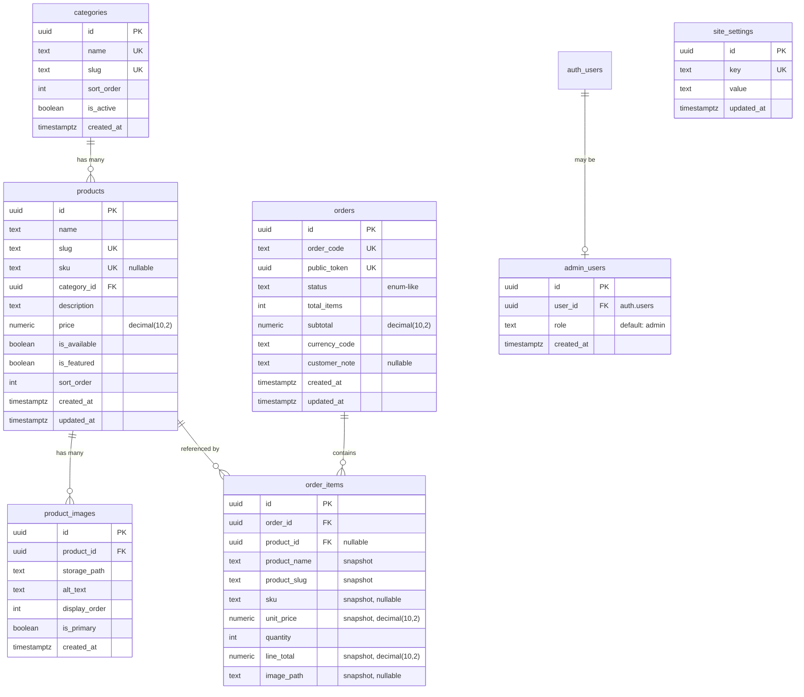
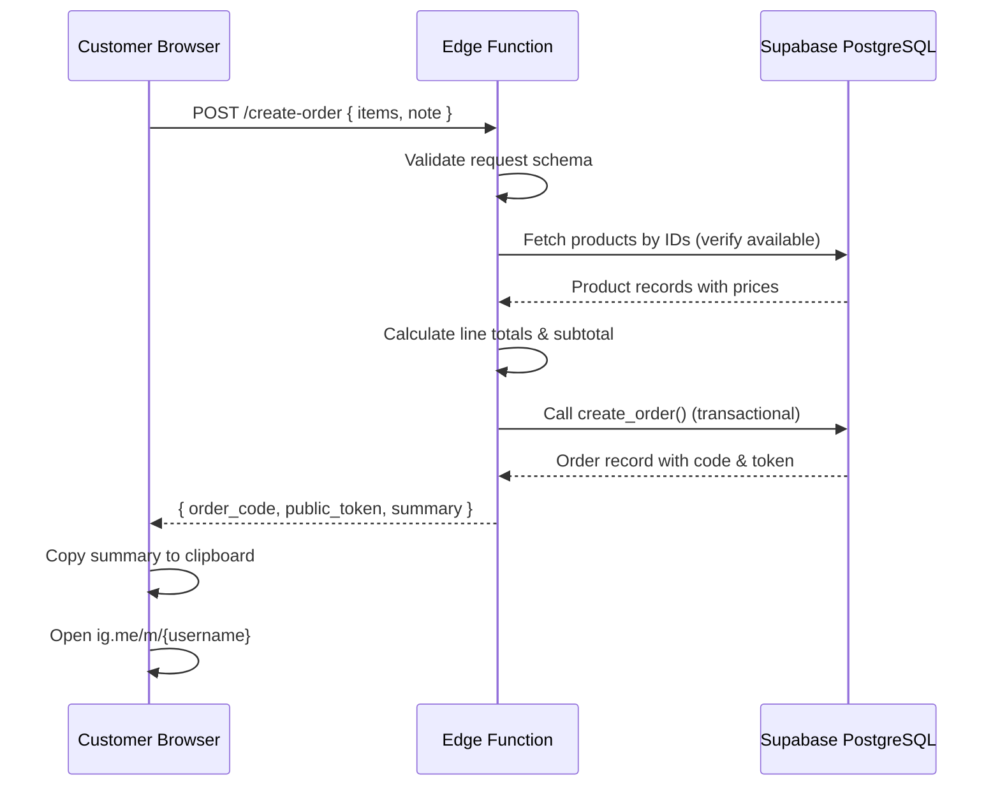
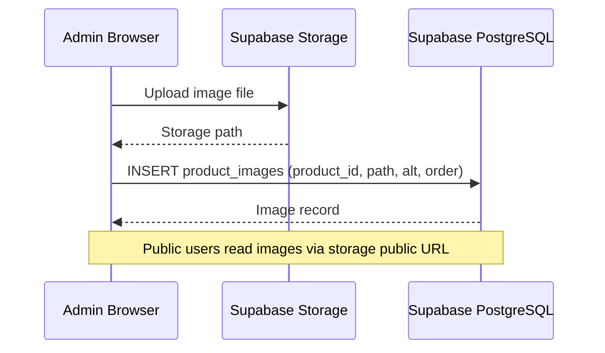

# DATABASE DESIGN — Metallics Jewellery Catalogue

## Entity Relationship Diagram



---

## Table Details

### categories

The four product categories. "All" is a virtual UI-only filter.

| Column | Type | Constraints | Notes |
|--------|------|-------------|-------|
| id | uuid | PK, default `gen_random_uuid()` | |
| name | text | NOT NULL, UNIQUE | e.g. "Earrings" |
| slug | text | NOT NULL, UNIQUE | e.g. "earrings" |
| sort_order | integer | NOT NULL, default 0 | Display ordering |
| is_active | boolean | NOT NULL, default true | Soft-hide categories |
| created_at | timestamptz | NOT NULL, default `now()` | |

**Seed data:**

| name | slug | sort_order |
|------|------|-----------|
| Earrings | earrings | 1 |
| Necklace | necklace | 2 |
| Bracelet | bracelet | 3 |
| Ring | ring | 4 |

---

### products

The core product catalogue.

| Column | Type | Constraints | Notes |
|--------|------|-------------|-------|
| id | uuid | PK, default `gen_random_uuid()` | |
| name | text | NOT NULL | |
| slug | text | NOT NULL, UNIQUE | URL-safe, auto-generated |
| sku | text | UNIQUE, nullable | Optional stock reference |
| category_id | uuid | FK → categories(id), NOT NULL | |
| description | text | default '' | |
| price | numeric(10,2) | NOT NULL, CHECK > 0 | |
| is_available | boolean | NOT NULL, default true | |
| is_featured | boolean | NOT NULL, default false | |
| sort_order | integer | NOT NULL, default 0 | |
| created_at | timestamptz | NOT NULL, default `now()` | |
| updated_at | timestamptz | NOT NULL, default `now()` | Updated via trigger |

**Indexes:**
- `idx_products_category_available` on `(category_id, is_available)`
- `idx_products_slug` on `(slug)`
- `idx_products_featured` on `(is_featured) WHERE is_featured = true`
- `idx_products_created_at` on `(created_at DESC)`
- `idx_products_sort_order` on `(sort_order, name)`

**Trigger:** `updated_at` auto-set on UPDATE.

---

### product_images

Multiple images per product with ordering.

| Column | Type | Constraints | Notes |
|--------|------|-------------|-------|
| id | uuid | PK, default `gen_random_uuid()` | |
| product_id | uuid | FK → products(id) ON DELETE CASCADE, NOT NULL | |
| storage_path | text | NOT NULL | Path in Supabase Storage |
| alt_text | text | default '' | Accessibility |
| display_order | integer | NOT NULL, default 0 | |
| is_primary | boolean | NOT NULL, default false | Main catalogue image |
| created_at | timestamptz | NOT NULL, default `now()` | |

**Index:** `idx_product_images_product` on `(product_id, display_order)`

**Constraint:** Only one `is_primary = true` per product (enforced via trigger or partial unique index).

---

### orders

Customer order records.

| Column | Type | Constraints | Notes |
|--------|------|-------------|-------|
| id | uuid | PK, default `gen_random_uuid()` | |
| order_code | text | NOT NULL, UNIQUE | Human-readable, e.g. `MET-20261120-A3X7` |
| public_token | uuid | NOT NULL, UNIQUE, default `gen_random_uuid()` | Secure public access |
| status | text | NOT NULL, default 'awaiting_dm' | One of: awaiting_dm, contacted, confirmed, completed, cancelled |
| total_items | integer | NOT NULL | Sum of all quantities |
| subtotal | numeric(10,2) | NOT NULL | Backend-calculated |
| currency_code | text | NOT NULL, default 'INR' | |
| customer_note | text | nullable | Max 500 chars |
| created_at | timestamptz | NOT NULL, default `now()` | |
| updated_at | timestamptz | NOT NULL, default `now()` | |

**Check constraint:** `status IN ('awaiting_dm', 'contacted', 'confirmed', 'completed', 'cancelled')`

**Indexes:**
- `idx_orders_public_token` on `(public_token)`
- `idx_orders_order_code` on `(order_code)`
- `idx_orders_status` on `(status)`
- `idx_orders_created_at` on `(created_at DESC)`

---

### order_items

Snapshot of products at order time. Prices are frozen.

| Column | Type | Constraints | Notes |
|--------|------|-------------|-------|
| id | uuid | PK, default `gen_random_uuid()` | |
| order_id | uuid | FK → orders(id) ON DELETE CASCADE, NOT NULL | |
| product_id | uuid | FK → products(id) ON SET NULL, nullable | May become null if product deleted |
| product_name | text | NOT NULL | Frozen at order time |
| product_slug | text | NOT NULL | Frozen at order time |
| sku | text | nullable | Frozen at order time |
| unit_price | numeric(10,2) | NOT NULL | Frozen at order time |
| quantity | integer | NOT NULL, CHECK > 0 | |
| line_total | numeric(10,2) | NOT NULL | unit_price × quantity |
| image_path | text | nullable | Primary image path frozen |

**Index:** `idx_order_items_order` on `(order_id)`

---

### admin_users

Maps Supabase Auth users to admin roles.

| Column | Type | Constraints | Notes |
|--------|------|-------------|-------|
| id | uuid | PK, default `gen_random_uuid()` | |
| user_id | uuid | FK → auth.users(id), UNIQUE, NOT NULL | |
| role | text | NOT NULL, default 'admin' | |
| created_at | timestamptz | NOT NULL, default `now()` | |

---

### site_settings

Key-value configuration store.

| Column | Type | Constraints | Notes |
|--------|------|-------------|-------|
| id | uuid | PK, default `gen_random_uuid()` | |
| key | text | NOT NULL, UNIQUE | |
| value | text | NOT NULL, default '' | |
| updated_at | timestamptz | NOT NULL, default `now()` | |

**Default keys:**

| Key | Default Value |
|-----|--------------|
| brand_name | Metallics |
| brand_tagline | Jewelry that highlights your individuality |
| instagram_username | (must configure) |
| currency_code | INR |
| currency_locale | en-IN |
| about_content | (empty) |

---

## Database Functions

### `is_admin()`

```sql
CREATE OR REPLACE FUNCTION public.is_admin()
RETURNS boolean AS $$
  SELECT EXISTS (
    SELECT 1 FROM public.admin_users
    WHERE user_id = auth.uid()
  );
$$ LANGUAGE sql SECURITY DEFINER STABLE;
```

Used in all admin RLS policies.

### `create_order(p_items jsonb, p_customer_note text DEFAULT NULL)`

Server-side transactional order creation function:

1. Validates all product IDs exist and are available
2. Fetches current prices from `products` table
3. Calculates line totals and subtotal
4. Generates `order_code` and `public_token`
5. Inserts `orders` row
6. Inserts all `order_items` rows with snapshots
7. Returns the complete order record

Called by the Edge Function with the service role key.

### `update_updated_at()`

Trigger function that sets `updated_at = now()` before UPDATE.

Applied to: `products`, `orders`, `site_settings`.

---

## Row Level Security Summary

### Public Access (anonymous / unauthenticated)

| Table | SELECT | INSERT | UPDATE | DELETE |
|-------|--------|--------|--------|--------|
| categories | ✓ `is_active = true` | ✗ | ✗ | ✗ |
| products | ✓ `is_available = true` | ✗ | ✗ | ✗ |
| product_images | ✓ via available product join | ✗ | ✗ | ✗ |
| orders | ✓ via `public_token` match | ✗ (Edge Function) | ✗ | ✗ |
| order_items | ✓ via order's `public_token` | ✗ (Edge Function) | ✗ | ✗ |
| admin_users | ✗ | ✗ | ✗ | ✗ |
| site_settings | ✓ all keys | ✗ | ✗ | ✗ |

### Admin Access (authenticated + in `admin_users`)

| Table | SELECT | INSERT | UPDATE | DELETE |
|-------|--------|--------|--------|--------|
| categories | ✓ all | ✓ | ✓ | ✓ |
| products | ✓ all | ✓ | ✓ | ✓ |
| product_images | ✓ all | ✓ | ✓ | ✓ |
| orders | ✓ all | ✓ | ✓ | ✗ |
| order_items | ✓ all | ✓ | ✗ | ✗ |
| admin_users | ✓ own row | ✗ | ✗ | ✗ |
| site_settings | ✓ all | ✓ | ✓ | ✗ |

### Storage: `product-images` Bucket

| Operation | Public | Admin |
|-----------|--------|-------|
| Read / Download | ✓ | ✓ |
| Upload | ✗ | ✓ |
| Update | ✗ | ✓ |
| Delete | ✗ | ✓ |

---

## Data Flow Diagrams

### Order Creation Flow



### Product Image Flow


